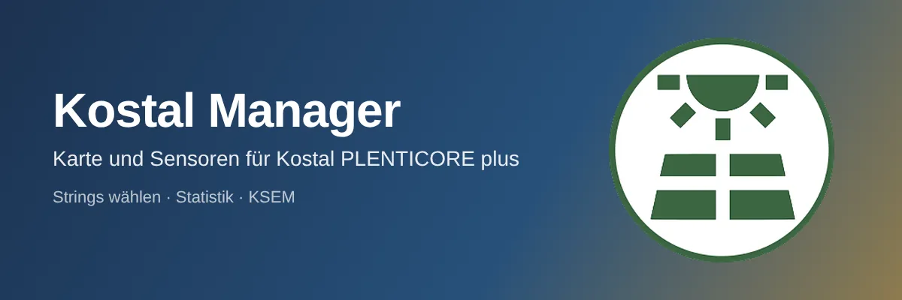
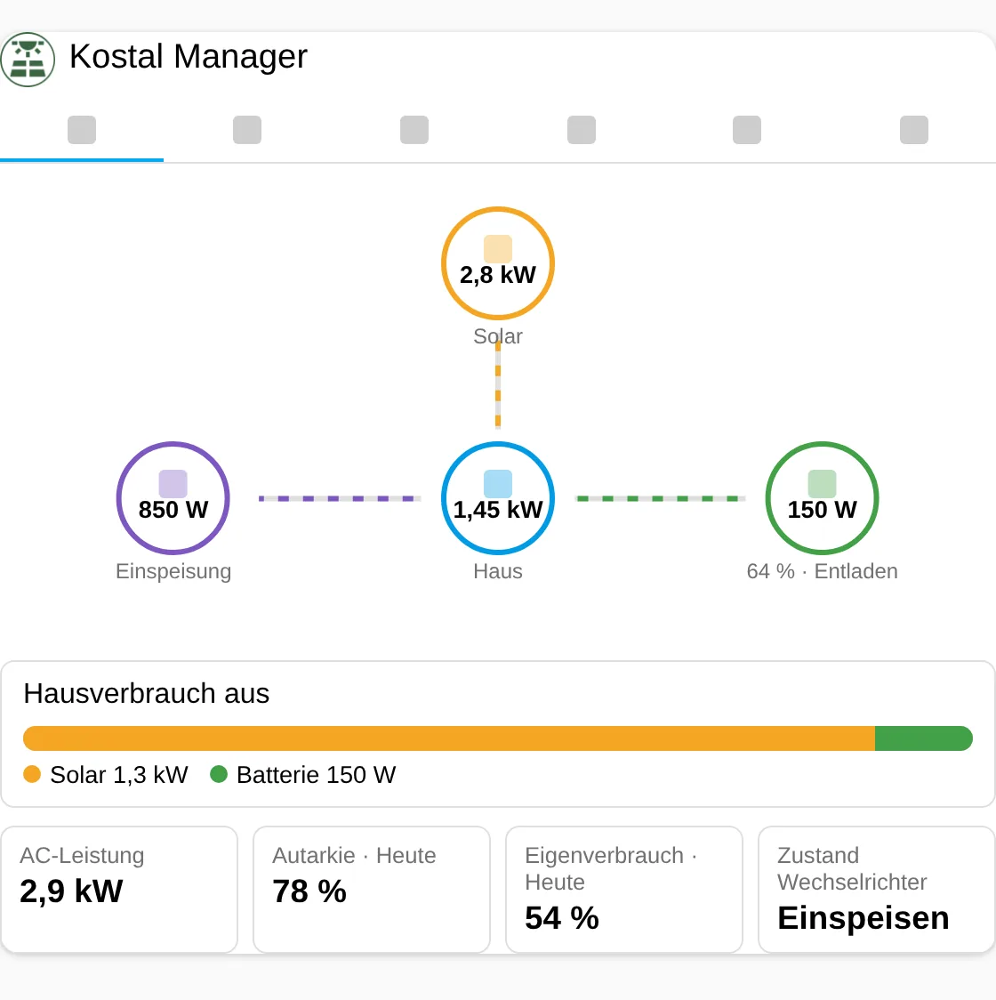
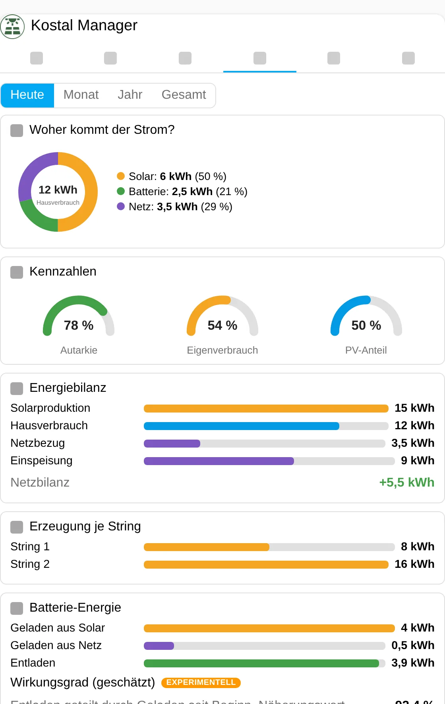
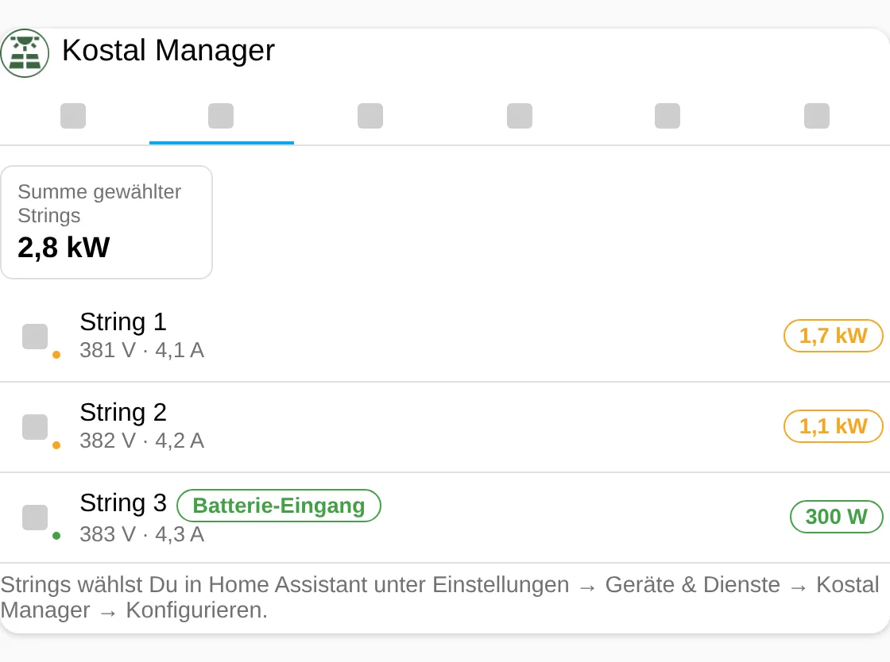
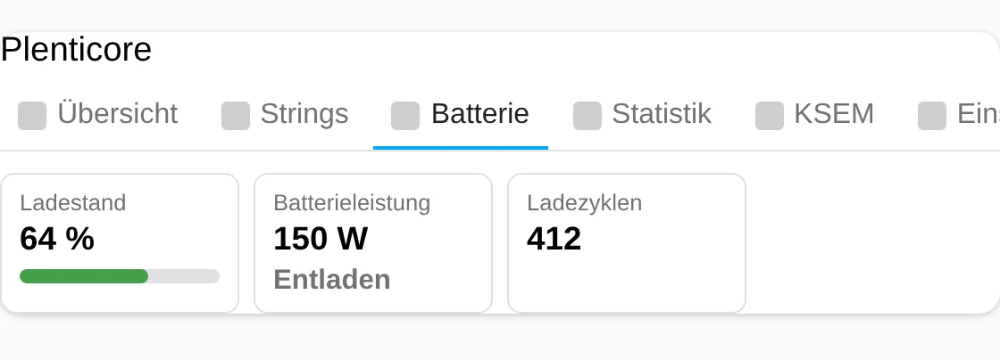
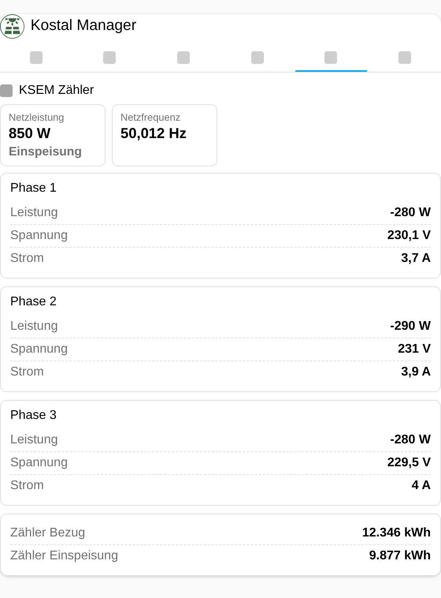
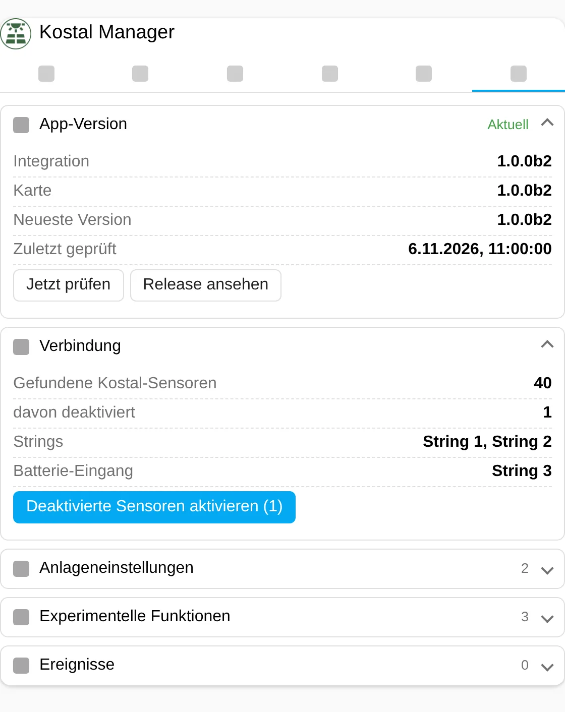

| [🇩🇪<br>**Deutsch**](README.md) | 🇬🇧<br>**English** | [🇳🇱<br>**Nederlands**](README.nl.md) |
|:-:|:-:|:-:|



# Kostal Manager

📖 Blog post: link follows once it is published.

Card and sensors for the Kostal PLENTICORE plus, built on top of the **official** Home Assistant integration "Kostal Plenticore Solar Inverter". The manager does not open a second connection to the inverter. It reads the entities of the official integration, shows only sensors that deliver values, calculates solar production from the strings you choose, and adds a visual statistics category. Optionally it reads a KOSTAL Smart Energy Meter (KSEM) via Modbus TCP.

> **Pre-release 1.0.0b1.** Everything was only tested against test data and simulated interfaces, nothing on a real plant. See [Known limitations](#known-limitations) and [EXPERIMENTELL.md](EXPERIMENTELL.md) (German).

This English README is a full translation of the German one (not checked by native speakers).

## Features

- **No prefix needed:** the entities of the Kostal config entry are found through the entity registry.
- **Only sensors with values:** a missing value or a disabled entity is not shown. A missing value is never shown as 0.
- **Choose strings:** in the setup dialog and in the options you decide which of the three DC inputs are PV strings and which one is the battery (default: strings 1 and 2 are PV, input 3 is the battery). The battery input never counts as PV.
- **New sensors:** solar power of the selected strings, solar production (today, month, year, total), PV share of home consumption, grid balance.
- **Categories (tabs):** overview with energy flow, strings, battery, statistics, KSEM (experimental), settings. Each category can be switched on and off in the editor.
- **Visual statistics:** period today, month, year or total; donut "Where does the power come from?", gauges for autarky, self-consumption and PV share, bars for energy balance, production per string and battery energy.
- **Plant settings:** minimum state of charge, minimum home consumption for discharge and battery strategy can be changed (administrators only, not in `read_only` mode).
- **Experimental (hidden):** KSEM via Modbus TCP and an estimated battery efficiency.
- Multilingual (German, English, Dutch) in setup, entities and card.

## New in 1.0.0b1

First release (pre-release). Everything is new.

## Images

The images show **test data**, not a real plant. Version shown: 1.0.0b1.

| | |
|---|---|
|  |  |
|  |  |
|  |  |

## Requirements

- Home Assistant 2025.6 or newer (tested only with 2026.2.3).
- The official **Kostal Plenticore Solar Inverter** integration is set up.
- The sensors you want to see are enabled. The official integration leaves most sensors disabled. The manager can enable them with one button (Settings tab, administrators only).
- Optional for KSEM: Modbus TCP enabled on the KSEM (port 502, unencrypted).

## Installation

**HACS:** HACS → Custom repositories → `https://github.com/Meine-smarte-Welt/kostal_manager` → category *Integration* → install → restart Home Assistant. HACS only shows pre-releases when "Show beta versions" is on.

**Manual:** copy the folder `custom_components/kostal_manager` to `config/custom_components/` and restart Home Assistant.

Then reload the browser (Ctrl+F5). The card resource is registered automatically (in Lovelace YAML mode you have to add it yourself: `/kostal_manager_files/kostal-manager-card.js`, type *JavaScript module*).

## Setup

1. Settings → Devices & services → Add integration → **Kostal Manager**.
2. If there are several Kostal entries, pick the right one.
3. Choose the PV strings and the battery input.
4. Add the card: edit dashboard → add card → **Kostal Manager**.
5. If the card says "No values yet", open the *Settings* tab and enable the disabled sensors.

Options (gear of the integration): change strings, then the "Experimental features" dialog.

## The card

```yaml
type: custom:kostal-manager-card
title: Photovoltaics
default_tab: overview
stats_period: day
show_strings: true
show_experimental: false
```

More examples are in `examples/`. All keys:

| Key | Default | Meaning |
|---|---|---|
| `title` / `show_title` | `Plenticore` / `true` | Heading (empty = none) |
| `entry_id` | – | Only with several manager entries |
| `show_overview`, `show_strings`, `show_battery`, `show_stats`, `show_ksem`, `show_settings` | `true` | Show/hide categories (at least one stays visible) |
| `default_tab` | `overview` | Start tab |
| `stats_period` | `day` | `day`, `month`, `year`, `total` |
| `zoom` | `100` | 50 to 150 percent |
| `read_only` | `false` | Hides all controls |
| `show_experimental` | `false` | Shows experimental features (the master switch in the options must also be on) |

The *KSEM* tab only appears when the master switch "Show experimental features" in the options, the KSEM switch **and** `show_experimental` in the card are all on.

## Colors

All colors can be set per card (editor section "Colors" or YAML). Allowed: hex, `rgb()`, `hsl()` and `var(--…)`. Invalid values are discarded.

| Key | Effect |
|---|---|
| `color_tab_active` | Active tab, primary buttons |
| `color_success`, `color_warning`, `color_error`, `color_info` | Status colors |
| `color_row_icon`, `color_live_banner` | Icons, banner |
| `color_solar`, `color_battery`, `color_grid`, `color_home` | Energy flow and statistics |
| `color_icon_<category>` | Icon color per tab (`overview`, `strings`, `battery`, `stats`, `ksem`, `settings`) |

## Services

The manager has no services of its own. Actions run through the card (administrators only).

## Events

No Home Assistant events are fired. The Settings tab keeps a log of actions since the card was loaded.

## Sensors

| Sensor | Unit | Note |
|---|---|---|
| Solar power (selected strings) | W | Sum of the selected PV strings |
| Solar production today / month / year / total | kWh | Sum of the yield counters of the selected strings |
| PV share of home consumption today / total | % | Consumption from solar divided by home consumption |
| Grid balance today (feed-in minus import) | kWh | |
| Battery efficiency (estimated) | % | experimental |
| `ksem_*`: grid power, frequency, per phase voltage, current, power, import and export counter | W, Hz, V, A, kWh | experimental |

If an input value is missing, the sensor is "unavailable" instead of 0. The value called "Energy Yield" in the official integration is **not** solar production; the manager therefore calculates it from the strings.

## Version display and update notice

The version is shown in the *Settings* tab (accordion "App version"), at the top of the card editor and in the options dialog. At startup and every 12 hours the manager asks GitHub for the latest version. A new version is highlighted in orange, as are different versions of card and integration (browser cache). If GitHub is unreachable it says "Check not possible"; the card keeps working.

## Settings

The *Settings* tab (gear) contains: app version, connection (found and disabled sensors, selected strings, button to enable them with two-click confirmation), plant settings, experimental (only visible with `show_experimental`) and events.

## Security

- Write actions (enable sensors, change plant settings) are for administrators only. The backend only allows entities the manager itself assigned to the Kostal integration and checks value ranges.
- All texts in the card are escaped, color values go through an allowlist.
- The manager sends nothing to the internet except the version query to `api.github.com`.
- The KSEM is only read (Modbus function 0x03).

## Known limitations

- **Not tested on real hardware.** Tested against test data, a simulated Modbus server and Home Assistant test fixtures (HA 2026.2.3); the card in Chromium with sample data.
- The assignment of Kostal entities uses normalized names (e.g. `dc1_power`, `battery_soc`). Whether this hits every sensor on your installation and language is untested. If the manager does not find a sensor, it is not shown.
- The official integration reads settings only about every 5 minutes.
- Whether enabling disabled sensors reloads the Kostal integration by itself is untested. Otherwise reload it from its menu.
- KSEM: port 502 without TLS only, the unit ID is unclear (default 1), only documented registers are read.
- The GitHub repository is a proposal (`Meine-smarte-Welt/kostal_manager`). While it does not exist, the update check reports "Check not possible".
- The translations (German, English, Dutch) were not checked by native speakers.
- The screenshots show test data.

## Troubleshooting

- **"No values yet":** sensors of the Kostal integration are disabled. *Settings* tab → "Enable disabled sensors", then wait a few seconds.
- **Unknown card:** clear the browser cache (Ctrl+F5); in YAML mode add the resource by hand.
- **KSEM tab missing:** check master switch, KSEM switch and `show_experimental`.
- **KSEM "modbus_exception_…":** try another unit ID in the options.
- **Diagnostics:** Settings → Devices & services → Kostal Manager → download diagnostics (without addresses and entity IDs).

## Version history

| Version | Change |
|---|---|
| **1.0.0b1** | First release (pre-release): assignment of Kostal entities, string selection, card with overview, strings, battery, statistics, settings; experimental: KSEM via Modbus, estimated battery efficiency. |

## File integrity

The `.py`, `.js` and `.yaml` files carry their SHA-256 checksum in line 1 (content from line 2). Check: `tail -n +2 file.py | sha256sum`. For JSON files (no comments possible) this table applies (SHA-256 of the complete file):

| Datei | SHA-256 |
|---|---|
| `hacs.json` | `d448c6dd7a98d8741a9fdcf500def761d4824c3b18c4a269246616f0c4f27a79` |
| `custom_components/kostal_manager/manifest.json` | `3126768f118b269b2c50fd97e6779f7509b0d35964d0413f0be03395b42a39b3` |
| `custom_components/kostal_manager/strings.json` | `6b47d0e918e0110fb7d8dbd1ba608520570d38ae04465f97fe37acbd7c29cf08` |
| `custom_components/kostal_manager/icons.json` | `ec9720e4d2be322a2f1a8cd5485d2360bc97dce15ef0f896686b679507b9427e` |
| `custom_components/kostal_manager/translations/de.json` | `6b47d0e918e0110fb7d8dbd1ba608520570d38ae04465f97fe37acbd7c29cf08` |
| `custom_components/kostal_manager/translations/en.json` | `220faf916ae077c5a38868f1bad61ca7d416507ce2285b4ef5ef67119d7d6606` |
| `custom_components/kostal_manager/translations/nl.json` | `87f97c1e204846ca305c0cacc5f35b3c76023bb9dd49101090cad10c1e070ba7` |

## License

MIT, see [LICENSE](LICENSE).
