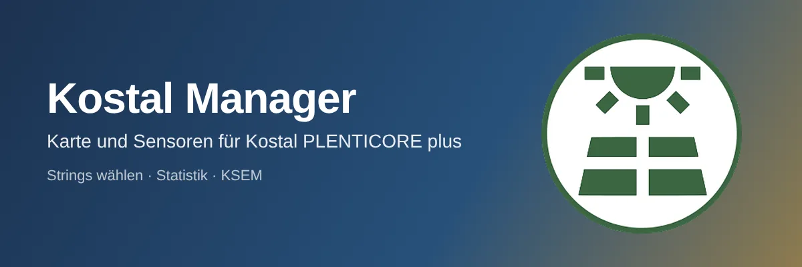
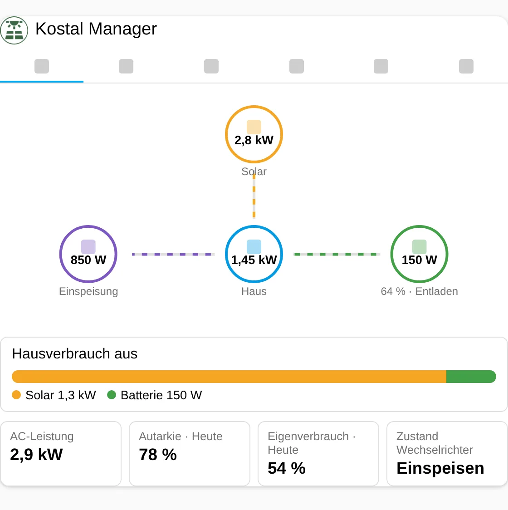
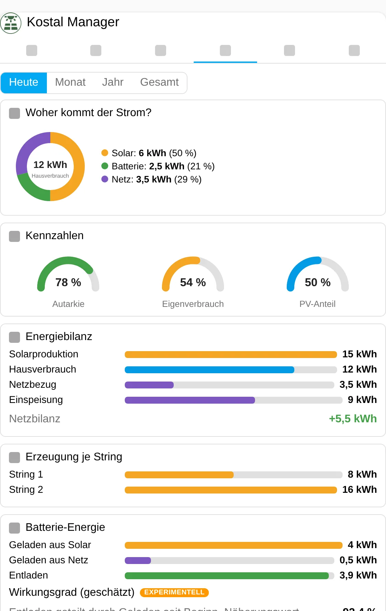
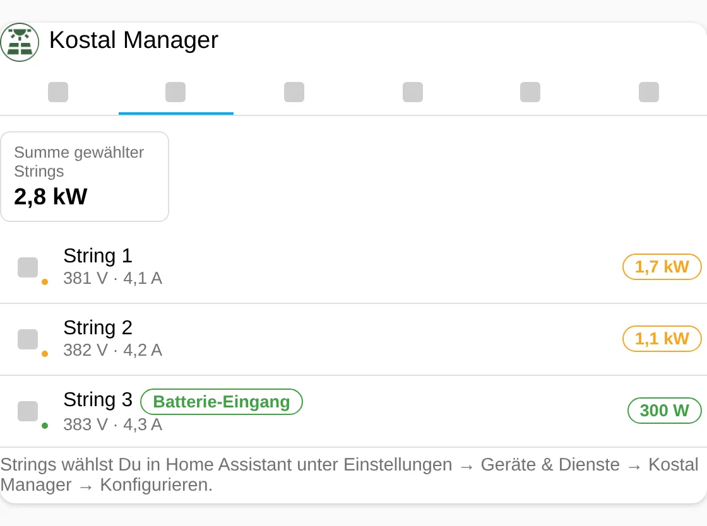
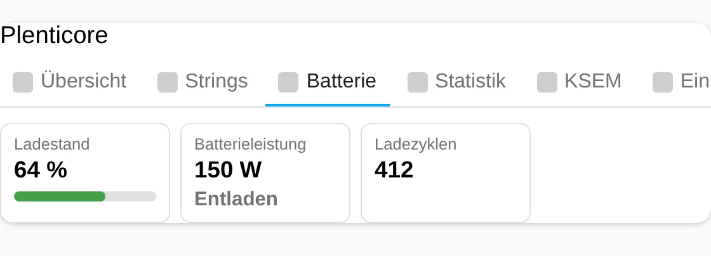
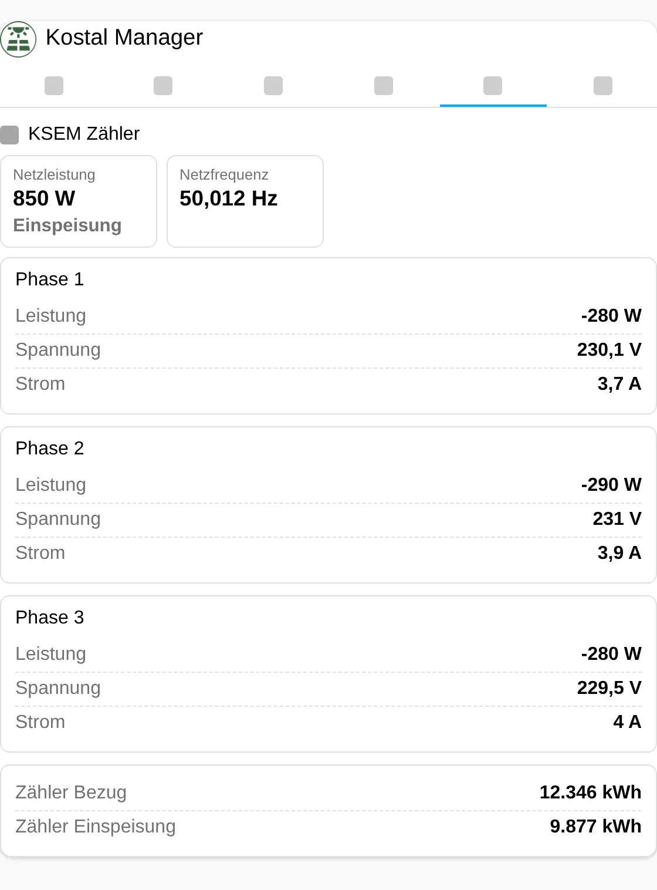
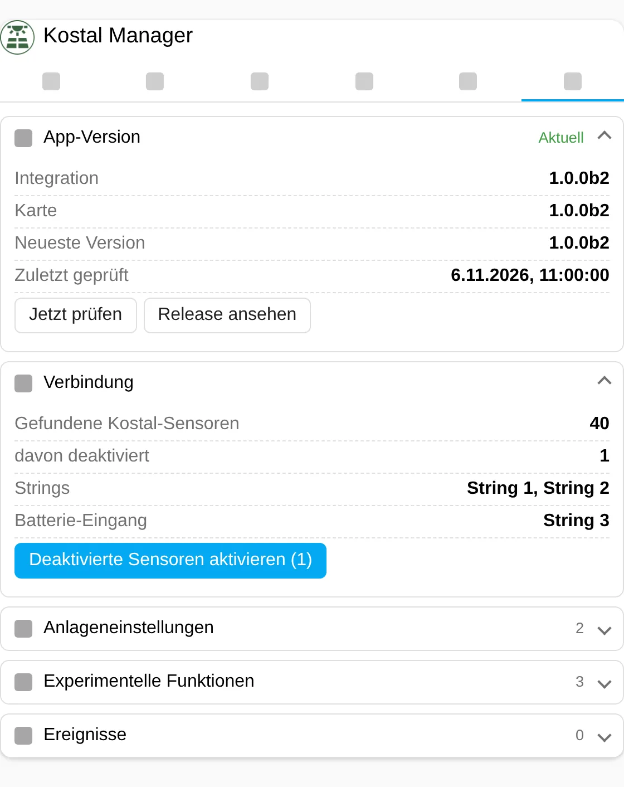
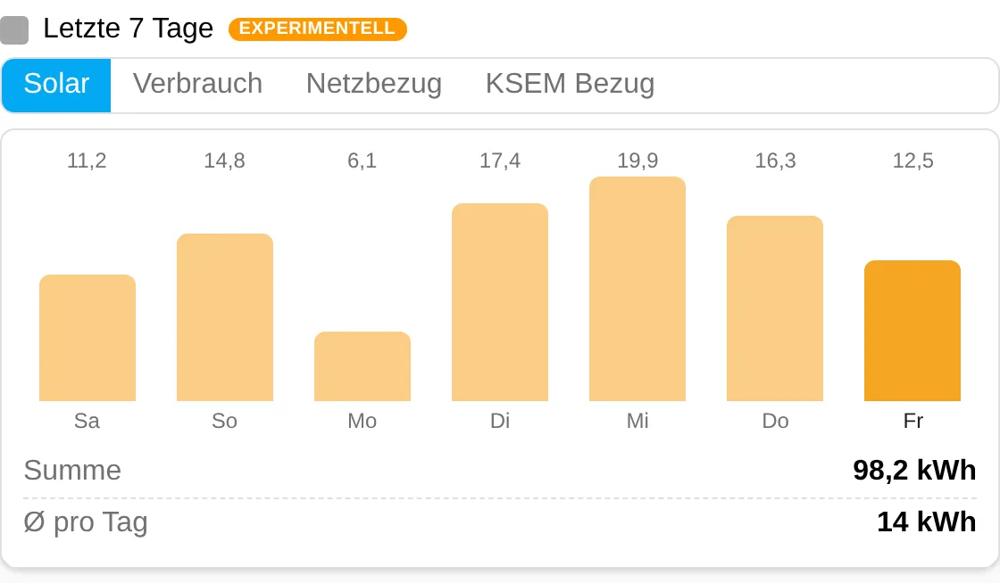
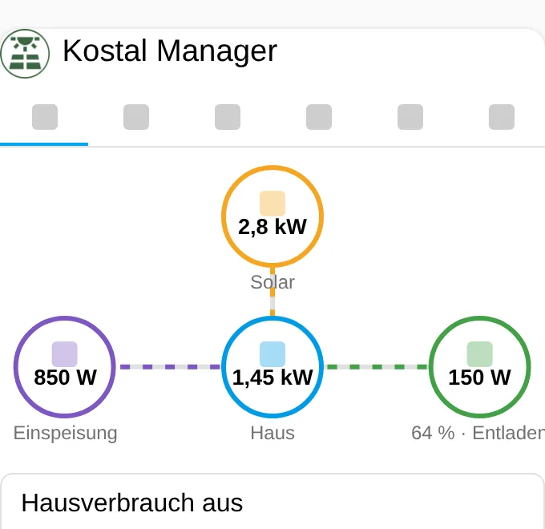

| 🇩🇪<br>**Deutsch** | [🇬🇧<br>**English**](README.en.md) | [🇳🇱<br>**Nederlands**](README.nl.md) |
|:-:|:-:|:-:|



# Kostal Manager

📖 Blogbeitrag: Link folgt, sobald er veröffentlicht ist.

Karte und Sensoren für den Kostal PLENTICORE plus, aufgebaut auf der **offiziellen** Home-Assistant-Integration „Kostal Plenticore Solar Inverter“. Der Manager öffnet keine zweite Verbindung zum Wechselrichter. Er liest die Entitäten der offiziellen Integration, zeigt nur Sensoren mit Werten, rechnet die Solarproduktion aus den von Dir gewählten Strings und ergänzt eine visuelle Statistik. Optional liest er einen KOSTAL Smart Energy Meter (KSEM) per Modbus TCP.

> **Vorabversion 1.0.0b2.** Alles wurde nur gegen Testdaten und simulierte Schnittstellen geprüft, nichts an einer echten Anlage. Siehe [Bekannte Einschränkungen](#bekannte-einschränkungen) und [EXPERIMENTELL.md](EXPERIMENTELL.md).

## Funktionsumfang

- **Kein Präfix nötig:** Die Entitäten der Kostal-Konfiguration werden über das Entitätsregister gefunden.
- **Nur Sensoren mit Werten:** Fehlt ein Wert oder ist die Entität deaktiviert, erscheint sie nicht. Ein fehlender Wert wird nie als 0 angezeigt.
- **Strings wählen:** Im Einrichtungsdialog und in den Optionen legst Du fest, welche der drei DC-Eingänge PV-Strings sind und welcher die Batterie ist (Standard: String 1 und 2 sind PV, Eingang 3 ist die Batterie). Der Batterie-Eingang zählt nie als PV.
- **Neue Sensoren:** Solarleistung der gewählten Strings, Solarproduktion (heute, Monat, Jahr, gesamt), PV-Anteil am Hausverbrauch, Netzbilanz.
- **Kategorien (Tabs):** Übersicht mit Energiefluss, Strings, Batterie, Statistik, KSEM, Einstellungen. Jede Kategorie lässt sich im Editor ein- und ausschalten. Bei wenig Platz zeigt die Tab-Leiste nur die Symbole, es gibt keinen Scrollbalken.
- **Visuelle Statistik:** Zeitraum Heute, Monat, Jahr oder Gesamt; Ringdiagramm „Woher kommt der Strom?“, Tachos für Autarkie, Eigenverbrauch und PV-Anteil, Balken für Energiebilanz, Erzeugung je String und Batterie-Energie.
- **Anlageneinstellungen:** Minimaler Ladestand, minimaler Hausverbrauch für Entladung und Batteriestrategie lassen sich ändern (nur Administratoren, nicht im Modus `read_only`).
- **KSEM:** Der KOSTAL Smart Energy Meter wird per Modbus TCP gelesen (nur lesend, eigene Adresse, nicht die des Wechselrichters). Eine Adresse in der Einrichtung oder den Optionen genügt, die Kategorie *KSEM* und die Sensoren `ksem_*` erscheinen dann von selbst. Die Funktion ist **nicht** experimentell, aber noch nicht an einer echten Anlage geprüft.
- **Experimentell (ausgeblendet):** 7-Tage-Balkendiagramm in der Statistik, eigene Seite „Kostal Manager“ in der Seitenleiste und ein geschätzter Batteriewirkungsgrad.
- Mehrsprachig (Deutsch, Englisch, Niederländisch) in Einrichtung, Entitäten und Karte.

## Neu in 1.0.0b2

Neues Symbol (Sonne über Solarmodulen, grün im Kreis): als Integrationssymbol und Logo in Home Assistant, im Kopf der Karte (wenn der Titel angezeigt wird) und in der Kopfzeile der Seitenleisten-Seite. Sonst keine Funktionsänderung gegenüber 1.0.0b1 (siehe Versionshistorie).

## Enthalten seit 1.0.0b1

Erste Veröffentlichung (Vorabversion). Alle Funktionen sind neu.

## Bilder

Die Bilder zeigen **Testdaten**, keine echte Anlage. Stand der Version: 1.0.0b2.

| | |
|---|---|
|  |  |
|  |  |
|  |  |
|  |  |

## Voraussetzungen

- Home Assistant ab 2025.6 (getestet nur mit 2026.2.3).
- Die offizielle Integration **Kostal Plenticore Solar Inverter** ist eingerichtet.
- Die Sensoren, die Du sehen möchtest, sind aktiviert. Die offizielle Integration lässt die meisten Sensoren deaktiviert. Der Manager kann sie auf Knopfdruck aktivieren (Einstellungen-Tab, nur Administratoren).
- Optional für KSEM: Modbus TCP am KSEM aktiviert (Port 502, unverschlüsselt). Der KSEM hat eine eigene IP-Adresse.

## Installation

**HACS:** HACS → Benutzerdefinierte Repositories → `https://github.com/Meine-smarte-Welt/kostal_manager` → Kategorie *Integration* → installieren → Home Assistant neu starten. Vorabversionen zeigt HACS nur, wenn „Beta-Versionen anzeigen“ eingeschaltet ist.

**Manuell:** Ordner `custom_components/kostal_manager` nach `config/custom_components/` kopieren, Home Assistant neu starten.

Danach Browser neu laden (Strg+F5). Die Karten-Ressource wird automatisch eingetragen (im YAML-Modus von Lovelace musst Du sie selbst eintragen: `/kostal_manager_files/kostal-manager-card.js`, Typ *JavaScript-Modul*).

## Einrichtung

1. Einstellungen → Geräte & Dienste → Integration hinzufügen → **Kostal Manager**.
2. Gibt es mehrere Kostal-Konfigurationen, wähle die passende.
3. Wähle die PV-Strings und den Eingang der Batterie.
4. Optional: Trage die Adresse Deines KSEM ein (leer lassen, wenn Du keinen hast). Port, Unit-ID und Intervall kannst Du später in den Optionen ändern.
5. Karte hinzufügen: Dashboard bearbeiten → Karte hinzufügen → **Kostal Manager**.
6. Zeigt die Karte „Noch keine Werte“, öffne den Tab *Einstellungen* und aktiviere die deaktivierten Sensoren.

Optionen (Zahnrad der Integration): Strings ändern, dann KSEM (Adresse, Port, Unit-ID, Intervall), dann der Dialog „Experimentelle Funktionen“ mit Hauptschalter und den Schaltern für Wirkungsgrad, 7-Tage-Diagramm und Seitenleisten-Seite.

## Die Karte

```yaml
type: custom:kostal-manager-card
title: Photovoltaik
default_tab: overview
stats_period: day
show_strings: true
show_experimental: false
```

Weitere Beispiele liegen in `examples/`. Alle Schlüssel:

| Schlüssel | Standard | Bedeutung |
|---|---|---|
| `title` / `show_title` | `Plenticore` / `true` | Überschrift (leer = keine) |
| `entry_id` | – | Nur bei mehreren Manager-Einträgen |
| `show_overview`, `show_strings`, `show_battery`, `show_stats`, `show_ksem`, `show_settings` | `true` | Kategorien ein-/ausblenden (mindestens eine bleibt sichtbar) |
| `default_tab` | `overview` | Starttab |
| `stats_period` | `day` | `day`, `month`, `year`, `total` |
| `zoom` | `100` | 50 bis 150 Prozent |
| `read_only` | `false` | Blendet alle Bedienelemente aus |
| `show_experimental` | `false` | Zeigt experimentelle Funktionen (zusätzlich muss der Hauptschalter in den Optionen an sein) |

Der Tab *KSEM* ist immer sichtbar. Ohne KSEM-Adresse erklärt er, was einzutragen ist. Das 7-Tage-Diagramm in der Statistik erscheint nur, wenn der Hauptschalter „Experimentelle Funktionen anzeigen“, der Schalter „7-Tage-Balkendiagramm“ **und** `show_experimental` in der Karte eingeschaltet sind. Es liest die Langzeitstatistik von Home Assistant (Recorder) und braucht aktivierte Energiezähler der Kostal-Integration.

## Farben

Alle Farben sind pro Karte einstellbar (Editor-Bereich „Farben“ oder YAML). Erlaubt sind Hex, `rgb()`, `hsl()` und `var(--…)`. Ungültiges wird verworfen.

| Schlüssel | Wirkung |
|---|---|
| `color_tab_active` | Aktiver Tab, Hauptknöpfe |
| `color_success`, `color_warning`, `color_error`, `color_info` | Statusfarben |
| `color_row_icon`, `color_live_banner` | Symbole, Banner |
| `color_solar`, `color_battery`, `color_grid`, `color_home` | Energiefluss und Statistik |
| `color_icon_<kategorie>` | Symbolfarbe je Tab (`overview`, `strings`, `battery`, `stats`, `ksem`, `settings`) |

## Services

Der Manager bringt keine eigenen Services mit. Aktionen laufen über die Karte (nur Administratoren).

## Ereignisse

Es werden keine Home-Assistant-Ereignisse ausgelöst. Der Einstellungen-Tab führt ein Protokoll der Aktionen seit dem Laden der Karte.

## Sensoren

| Sensor | Einheit | Hinweis |
|---|---|---|
| Solarleistung (gewählte Strings) | W | Summe der gewählten PV-Strings |
| Solarproduktion heute / Monat / Jahr / gesamt | kWh | Summe der Ertragszähler der gewählten Strings |
| PV-Anteil am Hausverbrauch heute / gesamt | % | Verbrauch aus Solar geteilt durch Hausverbrauch |
| Netzbilanz heute (Einspeisung minus Bezug) | kWh | |
| Batteriewirkungsgrad (geschätzt) | % | experimentell |
| `ksem_*`: Netzleistung, Frequenz, je Phase Spannung, Strom, Leistung, Zähler Bezug und Einspeisung (nur mit KSEM-Adresse) | W, Hz, V, A, kWh | ungeprüft |

Ist ein Eingangswert nicht vorhanden, ist der Sensor „nicht verfügbar“ statt 0. Der in der offiziellen Integration „Energy Yield“ genannte Wert ist **nicht** die Solarproduktion; der Manager rechnet sie deshalb aus den Strings.

## Versionsanzeige und Update-Hinweis

Die Version steht im Tab *Einstellungen* (Akkordeon „App-Version“), oben im Karten-Editor und im Optionen-Dialog. Beim Start und danach alle 12 Stunden fragt der Manager GitHub nach der neuesten Version. Eine neue Version wird orange hervorgehoben, ebenso unterschiedliche Versionen von Karte und Integration (Browser-Cache). Ist GitHub nicht erreichbar, steht dort „Prüfung nicht möglich“, die Karte läuft normal weiter.

## Einstellungen

Der Tab *Einstellungen* (Zahnrad) enthält: App-Version, Verbindung (gefundene und deaktivierte Sensoren, gewählte Strings, Knopf zum Aktivieren mit Zwei-Klick-Bestätigung), Anlageneinstellungen, Experimentell (nur sichtbar mit `show_experimental`) und Ereignisse.

## Sicherheit

- Schreibende Aktionen (Sensoren aktivieren, Anlageneinstellungen ändern) nur für Administratoren. Das Backend erlaubt nur Entitäten, die der Manager selbst der Kostal-Integration zugeordnet hat, und prüft Wertebereiche.
- Alle Texte in der Karte werden maskiert, Farbwerte laufen über eine Allowlist.
- Der Manager sendet nichts ins Internet außer der Versionsabfrage an `api.github.com`.
- Der KSEM wird nur gelesen (Modbus-Funktion 0x03).

## Bekannte Einschränkungen

- **Nicht an echter Hardware getestet.** Getestet wurde gegen Testdaten, einen simulierten Modbus-Server und Home-Assistant-Testfixtures (HA 2026.2.3), die Karte in Chromium mit Beispieldaten.
- Die Zuordnung der Kostal-Entitäten läuft über normalisierte Namen (z. B. `dc1_power`, `battery_soc`). Ob das bei Deiner Installation und Sprache jeden Sensor trifft, ist ungeprüft. Findet der Manager einen Sensor nicht, erscheint er nicht.
- Die offizielle Integration liest Einstellwerte nur etwa alle 5 Minuten.
- Ob das Aktivieren deaktivierter Sensoren die Kostal-Integration von selbst neu lädt, ist ungeprüft. Starte sie sonst über ihr Menü neu.
- Die Seitenleisten-Seite (experimentell) zeigt dieselbe Karte als Vollbild-Seite. Sie erscheint nach einem Neustart der Integration (Optionen speichern lädt sie neu) und ist für alle Benutzer sichtbar; Änderungen bleiben Administratoren vorbehalten.
- KSEM: nur Port 502 ohne TLS, die Unit-ID ist ungeklärt (Standard 1), nur dokumentierte Register werden gelesen.
- Das GitHub-Repository ist ein Vorschlag (`Meine-smarte-Welt/kostal_manager`). Solange es nicht existiert, meldet die Update-Prüfung „Prüfung nicht möglich“.
- Die Übersetzungen (Deutsch, Englisch, Niederländisch) sind nicht von Muttersprachlern geprüft.
- Die Screenshots zeigen Testdaten.

## Fehlerbehebung

- **„Noch keine Werte“:** Sensoren der Kostal-Integration sind deaktiviert. Tab *Einstellungen* → „Deaktivierte Sensoren aktivieren“, dann einige Sekunden warten.
- **Karte unbekannt:** Browser-Cache leeren (Strg+F5); im YAML-Modus die Ressource von Hand eintragen.
- **KSEM zeigt „Adresse eintragen“:** Adresse des KSEM in den Optionen der Integration eintragen (Modbus TCP muss am KSEM aktiv sein).
- **7-Tage-Diagramm fehlt:** Hauptschalter, Schalter „7-Tage-Balkendiagramm“ und `show_experimental` prüfen. Es braucht aktivierte Energiezähler und die Langzeitstatistik von Home Assistant.
- **KSEM „modbus_exception_…“:** Andere Unit-ID in den Optionen probieren.
- **Diagnose:** Einstellungen → Geräte & Dienste → Kostal Manager → Diagnose herunterladen (ohne Adressen und Entitäts-IDs).

## Versionshistorie

| Version | Änderung |
|---|---|
| **1.0.0b2** | Neues Symbol für Integration (`brand/`), Karte und Seitenleisten-Seite. Keine Funktionsänderung. |
| **1.0.0b1** | Erste Veröffentlichung (Vorabversion): Zuordnung der Kostal-Entitäten, Stringauswahl, Karte mit Übersicht, Strings, Batterie, Statistik, Einstellungen; KSEM per Modbus (nicht experimentell, ungeprüft), Tab-Leiste ohne Scrollbalken; experimentell: 7-Tage-Balkendiagramm, Seitenleisten-Seite, geschätzter Batteriewirkungsgrad. |

## Datei-Integrität

Die `.py`-, `.js`- und `.yaml`-Dateien tragen in Zeile 1 ihre SHA-256-Prüfsumme (Inhalt ab Zeile 2). Prüfen: `tail -n +2 datei.py | sha256sum`. Für JSON-Dateien (keine Kommentare möglich) gilt diese Tabelle (SHA-256 der kompletten Datei):

| Datei | SHA-256 |
|---|---|
| `hacs.json` | `d448c6dd7a98d8741a9fdcf500def761d4824c3b18c4a269246616f0c4f27a79` |
| `custom_components/kostal_manager/manifest.json` | `811222af9eb0e482e45687fc282aeaeee3c654d28ab358fd8bf7540135780130` |
| `custom_components/kostal_manager/strings.json` | `549d1a52d3368de1cb990be2077823a79f4fd5e4842843b85061f07190f8be18` |
| `custom_components/kostal_manager/icons.json` | `ec9720e4d2be322a2f1a8cd5485d2360bc97dce15ef0f896686b679507b9427e` |
| `custom_components/kostal_manager/translations/de.json` | `549d1a52d3368de1cb990be2077823a79f4fd5e4842843b85061f07190f8be18` |
| `custom_components/kostal_manager/translations/en.json` | `53b1a31c1528df133490c50fa590c8d23d017243109ad3efd8431278143b23ff` |
| `custom_components/kostal_manager/translations/nl.json` | `f6342c536164780c12efbb15936d4d3d724928a36e7ae6f114bc738c679f691d` |

## Lizenz

MIT, siehe [LICENSE](LICENSE).
