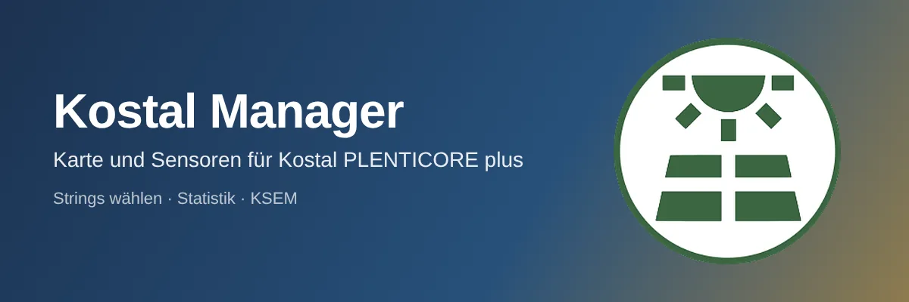
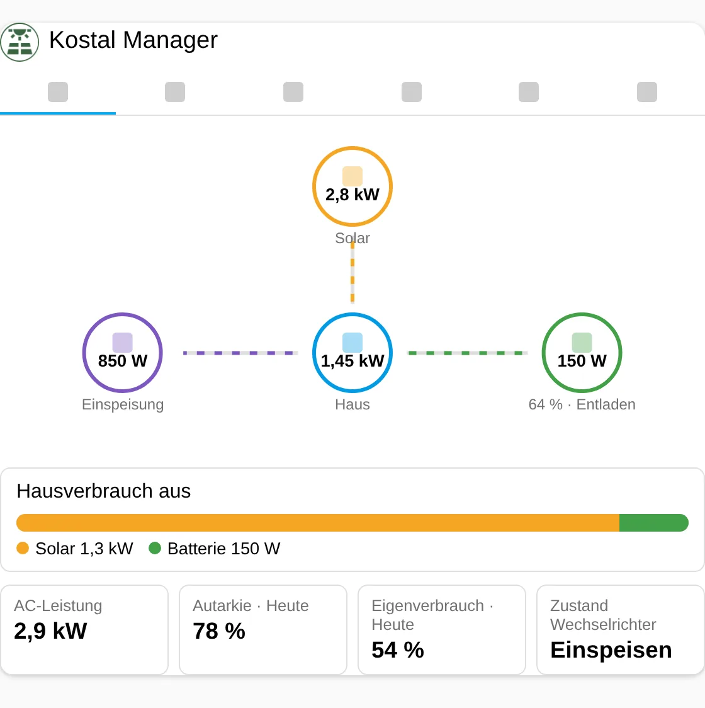
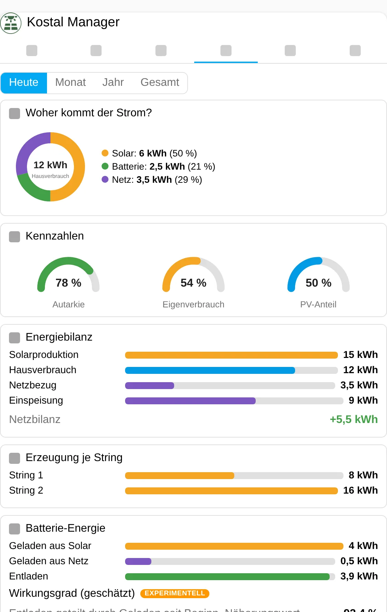
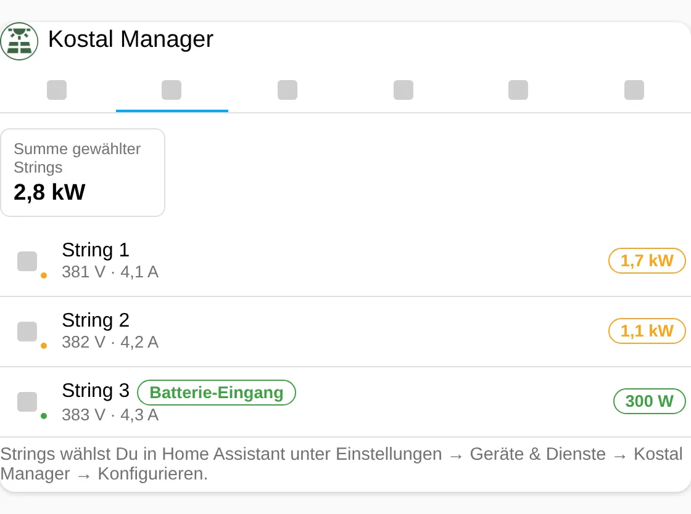
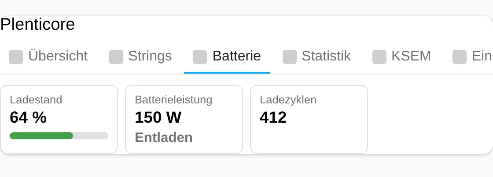
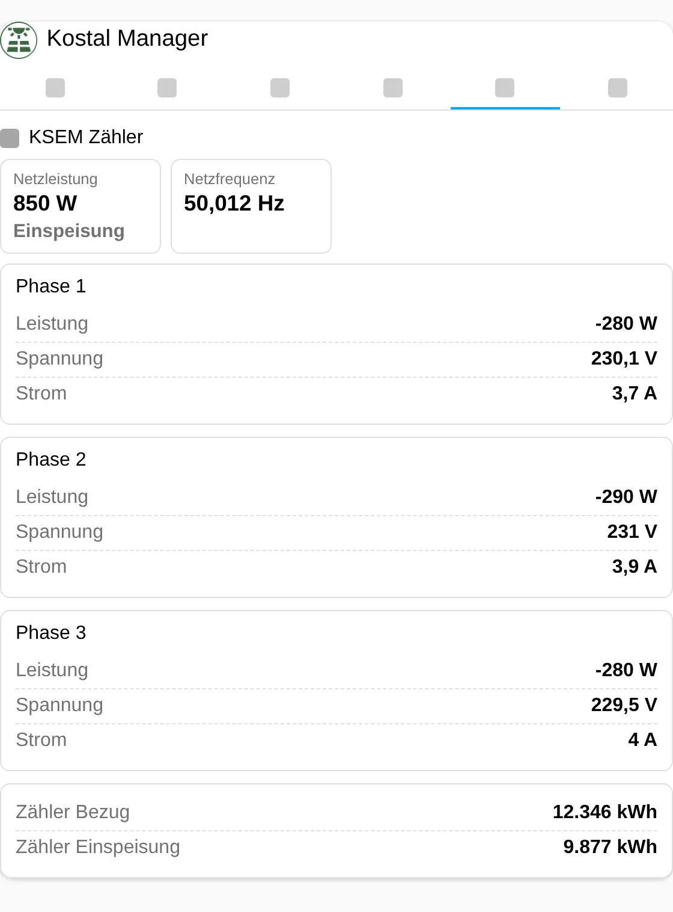
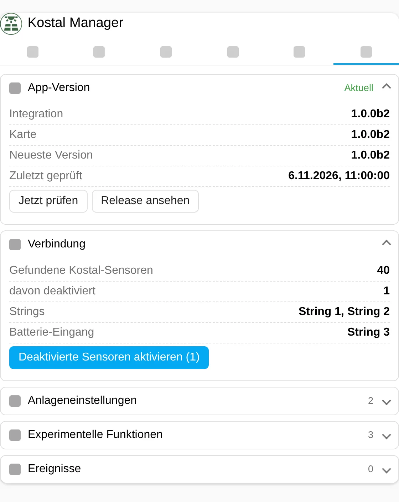

| [🇩🇪<br>**Deutsch**](README.md) | [🇬🇧<br>**English**](README.en.md) | 🇳🇱<br>**Nederlands** |
|:-:|:-:|:-:|



# Kostal Manager

📖 Blogbericht: link volgt zodra het is gepubliceerd.

Kaart en sensoren voor de Kostal PLENTICORE plus, gebouwd op de **officiële** Home Assistant-integratie "Kostal Plenticore Solar Inverter". De manager opent geen tweede verbinding met de omvormer. Hij leest de entiteiten van de officiële integratie, toont alleen sensoren met waarden, berekent de zonneproductie uit de strings die je kiest en voegt een visuele statistiekcategorie toe. Optioneel leest hij een KOSTAL Smart Energy Meter (KSEM) via Modbus TCP.

> **Voorversie 1.0.0b1.** Alles is alleen getest met testgegevens en gesimuleerde interfaces, niets op een echte installatie. Zie [Bekende beperkingen](#bekende-beperkingen) en [EXPERIMENTELL.md](EXPERIMENTELL.md) (Duits).

Deze Nederlandse README is een volledige vertaling van de Duitse (niet gecontroleerd door moedertaalsprekers).

## Functies

- **Geen prefix nodig:** de entiteiten van de Kostal-configuratie worden via het entiteitenregister gevonden.
- **Alleen sensoren met waarden:** een ontbrekende waarde of uitgeschakelde entiteit wordt niet getoond. Een ontbrekende waarde wordt nooit als 0 getoond.
- **Strings kiezen:** in het installatiedialoog en in de opties bepaal je welke van de drie DC-ingangen PV-strings zijn en welke de batterij is (standaard: string 1 en 2 zijn PV, ingang 3 is de batterij). De batterij-ingang telt nooit als PV.
- **Nieuwe sensoren:** zonnevermogen van de gekozen strings, zonneproductie (vandaag, maand, jaar, totaal), PV-aandeel in huisverbruik, netsaldo.
- **Categorieën (tabs):** overzicht met energiestroom, strings, batterij, statistiek, KSEM (experimenteel), instellingen. Elke categorie kan in de editor aan- en uitgezet worden.
- **Visuele statistiek:** periode vandaag, maand, jaar of totaal; ringdiagram "Waar komt de stroom vandaan?", metertjes voor autarkie, eigenverbruik en PV-aandeel, balken voor energiebalans, opwek per string en batterij-energie.
- **Installatie-instellingen:** minimale laadtoestand, minimaal huisverbruik voor ontladen en batterijstrategie zijn aan te passen (alleen beheerders, niet in `read_only`-modus).
- **Experimenteel (verborgen):** KSEM via Modbus TCP en een geschat batterijrendement.
- Meertalig (Duits, Engels, Nederlands) in installatie, entiteiten en kaart.

## Nieuw in 1.0.0b1

Eerste uitgave (voorversie). Alles is nieuw.

## Afbeeldingen

De afbeeldingen tonen **testgegevens**, geen echte installatie. Getoonde versie: 1.0.0b1.

| | |
|---|---|
|  |  |
|  |  |
|  |  |

## Vereisten

- Home Assistant 2025.6 of nieuwer (alleen getest met 2026.2.3).
- De officiële integratie **Kostal Plenticore Solar Inverter** is ingesteld.
- De sensoren die je wilt zien zijn ingeschakeld. De officiële integratie laat de meeste sensoren uitgeschakeld. De manager kan ze met één knop inschakelen (tab Instellingen, alleen beheerders).
- Optioneel voor KSEM: Modbus TCP ingeschakeld op de KSEM (poort 502, onversleuteld).

## Installatie

**HACS:** HACS → Aangepaste repositories → `https://github.com/Meine-smarte-Welt/kostal_manager` → categorie *Integratie* → installeren → Home Assistant herstarten. HACS toont voorversies alleen als "Bètaversies tonen" aan staat.

**Handmatig:** kopieer de map `custom_components/kostal_manager` naar `config/custom_components/` en herstart Home Assistant.

Laad daarna de browser opnieuw (Ctrl+F5). De kaartresource wordt automatisch geregistreerd (in Lovelace-YAML-modus moet je hem zelf toevoegen: `/kostal_manager_files/kostal-manager-card.js`, type *JavaScript-module*).

## Instellen

1. Instellingen → Apparaten & services → Integratie toevoegen → **Kostal Manager**.
2. Zijn er meerdere Kostal-configuraties, kies de juiste.
3. Kies de PV-strings en de ingang van de batterij.
4. Kaart toevoegen: dashboard bewerken → kaart toevoegen → **Kostal Manager**.
5. Zegt de kaart "Nog geen waarden", open dan de tab *Instellingen* en schakel de uitgeschakelde sensoren in.

Opties (tandwiel van de integratie): strings wijzigen, daarna het dialoog "Experimentele functies".

## De kaart

```yaml
type: custom:kostal-manager-card
title: Zonnepanelen
default_tab: overview
stats_period: day
show_strings: true
show_experimental: false
```

Meer voorbeelden staan in `examples/`. Alle sleutels:

| Sleutel | Standaard | Betekenis |
|---|---|---|
| `title` / `show_title` | `Plenticore` / `true` | Kop (leeg = geen) |
| `entry_id` | – | Alleen bij meerdere manager-items |
| `show_overview`, `show_strings`, `show_battery`, `show_stats`, `show_ksem`, `show_settings` | `true` | Categorieën tonen/verbergen (minstens één blijft zichtbaar) |
| `default_tab` | `overview` | Starttab |
| `stats_period` | `day` | `day`, `month`, `year`, `total` |
| `zoom` | `100` | 50 tot 150 procent |
| `read_only` | `false` | Verbergt alle bedieningselementen |
| `show_experimental` | `false` | Toont experimentele functies (de hoofdschakelaar in de opties moet ook aan staan) |

De tab *KSEM* verschijnt alleen als de hoofdschakelaar "Experimentele functies tonen" in de opties, de KSEM-schakelaar **en** `show_experimental` in de kaart aan staan.

## Kleuren

Alle kleuren zijn per kaart in te stellen (editorgedeelte "Kleuren" of YAML). Toegestaan: hex, `rgb()`, `hsl()` en `var(--…)`. Ongeldige waarden worden genegeerd.

| Sleutel | Werking |
|---|---|
| `color_tab_active` | Actieve tab, hoofdknoppen |
| `color_success`, `color_warning`, `color_error`, `color_info` | Statuskleuren |
| `color_row_icon`, `color_live_banner` | Pictogrammen, banner |
| `color_solar`, `color_battery`, `color_grid`, `color_home` | Energiestroom en statistiek |
| `color_icon_<categorie>` | Pictogramkleur per tab (`overview`, `strings`, `battery`, `stats`, `ksem`, `settings`) |

## Services

De manager heeft geen eigen services. Acties lopen via de kaart (alleen beheerders).

## Gebeurtenissen

Er worden geen Home Assistant-gebeurtenissen afgevuurd. De tab Instellingen houdt een logboek bij van acties sinds het laden van de kaart.

## Sensoren

| Sensor | Eenheid | Opmerking |
|---|---|---|
| Zonnevermogen (gekozen strings) | W | Som van de gekozen PV-strings |
| Zonneproductie vandaag / maand / jaar / totaal | kWh | Som van de opbrengsttellers van de gekozen strings |
| PV-aandeel in huisverbruik vandaag / totaal | % | Verbruik uit zon gedeeld door huisverbruik |
| Netsaldo vandaag (teruglevering min afname) | kWh | |
| Batterijrendement (geschat) | % | experimenteel |
| `ksem_*`: netvermogen, frequentie, per fase spanning, stroom, vermogen, teller afname en teruglevering | W, Hz, V, A, kWh | experimenteel |

Ontbreekt een invoerwaarde, dan is de sensor "niet beschikbaar" in plaats van 0. De waarde "Energy Yield" in de officiële integratie is **niet** de zonneproductie; de manager berekent die daarom uit de strings.

## Versieweergave en updatemelding

De versie staat in de tab *Instellingen* (accordeon "App-versie"), bovenaan de kaarteditor en in het optiesdialoog. Bij het starten en daarna elke 12 uur vraagt de manager GitHub om de nieuwste versie. Een nieuwe versie wordt oranje gemarkeerd, net als verschillende versies van kaart en integratie (browsercache). Is GitHub onbereikbaar, dan staat er "Controle niet mogelijk"; de kaart blijft gewoon werken.

## Instellingen

De tab *Instellingen* (tandwiel) bevat: app-versie, verbinding (gevonden en uitgeschakelde sensoren, gekozen strings, knop om ze in te schakelen met bevestiging in twee klikken), installatie-instellingen, experimenteel (alleen zichtbaar met `show_experimental`) en gebeurtenissen.

## Beveiliging

- Schrijvende acties (sensoren inschakelen, installatie-instellingen wijzigen) alleen voor beheerders. De backend staat alleen entiteiten toe die de manager zelf aan de Kostal-integratie heeft gekoppeld en controleert waardebereiken.
- Alle teksten in de kaart worden geëscaped, kleurwaarden lopen via een allowlist.
- De manager stuurt niets het internet op behalve de versievraag aan `api.github.com`.
- De KSEM wordt alleen gelezen (Modbus-functie 0x03).

## Bekende beperkingen

- **Niet op echte hardware getest.** Getest met testgegevens, een gesimuleerde Modbus-server en Home Assistant-testfixtures (HA 2026.2.3); de kaart in Chromium met voorbeeldgegevens.
- De koppeling van Kostal-entiteiten gebruikt genormaliseerde namen (bijv. `dc1_power`, `battery_soc`). Of dat bij jouw installatie en taal elke sensor raakt, is niet getest. Vindt de manager een sensor niet, dan wordt die niet getoond.
- De officiële integratie leest instellingswaarden slechts ongeveer elke 5 minuten.
- Of het inschakelen van uitgeschakelde sensoren de Kostal-integratie vanzelf herlaadt, is niet getest. Herlaad hem anders via zijn menu.
- KSEM: alleen poort 502 zonder TLS, de unit-ID is onduidelijk (standaard 1), alleen gedocumenteerde registers worden gelezen.
- De GitHub-repository is een voorstel (`Meine-smarte-Welt/kostal_manager`). Zolang die niet bestaat, meldt de updatecontrole "Controle niet mogelijk".
- De vertalingen (Duits, Engels, Nederlands) zijn niet door moedertaalsprekers gecontroleerd.
- De schermafbeeldingen tonen testgegevens.

## Problemen oplossen

- **"Nog geen waarden":** sensoren van de Kostal-integratie zijn uitgeschakeld. Tab *Instellingen* → "Uitgeschakelde sensoren inschakelen", daarna enkele seconden wachten.
- **Onbekende kaart:** browsercache wissen (Ctrl+F5); in YAML-modus de resource handmatig toevoegen.
- **KSEM-tab ontbreekt:** controleer hoofdschakelaar, KSEM-schakelaar en `show_experimental`.
- **KSEM "modbus_exception_…":** probeer een andere unit-ID in de opties.
- **Diagnose:** Instellingen → Apparaten & services → Kostal Manager → diagnose downloaden (zonder adressen en entiteits-ID's).

## Versiegeschiedenis

| Versie | Wijziging |
|---|---|
| **1.0.0b1** | Eerste uitgave (voorversie): koppeling van Kostal-entiteiten, stringkeuze, kaart met overzicht, strings, batterij, statistiek, instellingen; experimenteel: KSEM via Modbus, geschat batterijrendement. |

## Bestandsintegriteit

De `.py`-, `.js`- en `.yaml`-bestanden dragen in regel 1 hun SHA-256-controlesom (inhoud vanaf regel 2). Controleren: `tail -n +2 bestand.py | sha256sum`. Voor JSON-bestanden (geen opmerkingen mogelijk) geldt deze tabel (SHA-256 van het volledige bestand):

| Datei | SHA-256 |
|---|---|
| `hacs.json` | `d448c6dd7a98d8741a9fdcf500def761d4824c3b18c4a269246616f0c4f27a79` |
| `custom_components/kostal_manager/manifest.json` | `3126768f118b269b2c50fd97e6779f7509b0d35964d0413f0be03395b42a39b3` |
| `custom_components/kostal_manager/strings.json` | `6b47d0e918e0110fb7d8dbd1ba608520570d38ae04465f97fe37acbd7c29cf08` |
| `custom_components/kostal_manager/icons.json` | `ec9720e4d2be322a2f1a8cd5485d2360bc97dce15ef0f896686b679507b9427e` |
| `custom_components/kostal_manager/translations/de.json` | `6b47d0e918e0110fb7d8dbd1ba608520570d38ae04465f97fe37acbd7c29cf08` |
| `custom_components/kostal_manager/translations/en.json` | `220faf916ae077c5a38868f1bad61ca7d416507ce2285b4ef5ef67119d7d6606` |
| `custom_components/kostal_manager/translations/nl.json` | `87f97c1e204846ca305c0cacc5f35b3c76023bb9dd49101090cad10c1e070ba7` |

## Licentie

MIT, zie [LICENSE](LICENSE).
